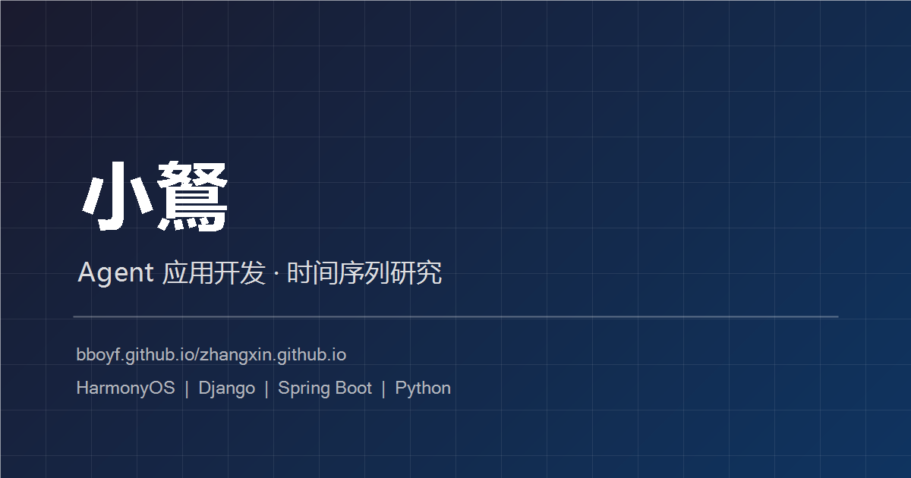

# 小鑫 · 个人主页

> 一个纯静态的个人项目主页，无构建步骤、无框架、无境外 CDN 依赖。

**线上地址**：https://bboyf.github.io/zhangxin.github.io/



## 关于

Agent 应用开发 / 时间序列研究方向，研究生在读。这个仓库是我的个人主页源码，
用来集中展示项目作品与技术栈。

## 技术实现

| 项目 | 说明 |
|------|------|
| 页面结构 | 手写 HTML5 语义化标签，单页锚点导航 |
| 样式 | 原生 CSS（Grid / Flex / 自定义属性），Bento Grid 布局 |
| 动画 | GSAP 3 + ScrollTrigger 滚动动画，Lenis 平滑滚动 |
| 字体 | Syncopate + Manrope，已自托管为 woff2 子集 |
| 图标 | 内联 SVG sprite，不加载图标字体 |
| 脚本 | 原生 JavaScript（ES5 语法，无构建、无依赖） |

## 目录结构

```
.
├── index.html              # 页面主体（含 meta / OG / 内联图标精灵）
├── style.css               # 全部样式
├── script.js               # 动画、菜单、时钟、日历
├── vendor/                 # 本地化的第三方资源
│   ├── gsap.min.js
│   ├── ScrollTrigger.min.js
│   ├── lenis.min.js
│   ├── fonts.css
│   └── fonts/              # woff2 字体子集
├── assets/
│   └── og-card.png         # 社交分享缩略图（1200×630）
├── robots.txt
├── sitemap.xml
└── deploy.bat              # Windows 一键发布脚本
```

## 本地预览

直接双击 `index.html` 即可，无需安装任何依赖。

需要本地服务器时（推荐，避免部分浏览器的 file:// 限制）：

```bash
python -m http.server 8000
# 打开 http://localhost:8000
```

## 发布

Windows 下双击 `deploy.bat`，输入更新说明后自动提交并推送；
推送到 `master` 分支后 GitHub Pages 会在 1–2 分钟内完成部署。

## 设计说明

- **渐进增强**：动画依赖的库全部本地化；若任一库加载失败，`<html>` 上的 `js`
  类名不会被添加，首屏标题与大标题直接静态显示，不会出现「空白页」。
- **无障碍**：支持键盘焦点环、移动端菜单 `aria-expanded` / ESC 关闭与背景滚动锁定、
  日历当前日期 `aria-current`，并遵循系统 `prefers-reduced-motion` 设置。
- **零外部请求**：除 GitHub 自身外，页面不向任何第三方域名发起请求。
